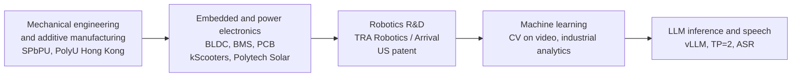
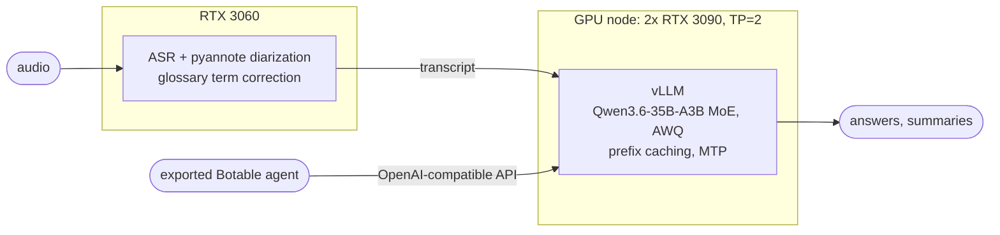

<h1 align="center">Ivan Kononov</h1>

  <b>Engineer who ships hardware and AI</b> 
  LLM inference on NVIDIA GPUs &middot; speech-to-text &middot; LLM evaluation &middot; embedded, composites, additive manufacturing 
  Astana, Kazakhstan

  
  
  
  
  

  
  
  

I started in mechanical engineering and additive manufacturing, built motor controllers, battery
boards and carbon-fibre parts for vehicle prototypes, and co-invented a dispenser for a robotic
production line. Today I serve and measure LLM and speech workloads on self-hosted NVIDIA GPUs and
take client AI systems from a brief to production. Same habit in both: measure, then decide.

| | |
|---|---|
| **Patents** | Co-inventor, [US 10,994,299](https://patents.google.com/patent/US10994299B2/en): two-component adhesive dispenser with a mixing unit replacement system for a robotic line (TRA Robotics, later Arrival, 2018). Inventor, [RU 2,780,879](https://patents.google.com/patent/RU2780879C1/en): electric scooter (2022). |
| **LLM inference** | vLLM serving a 35B MoE model with TP=2 on two RTX 3090: power study per card, 5.1M prefill tokens of sustained load without Xid errors, 2.1x decode with MTP speculative decoding. |
| **Teaching** | Master's thesis supervisor at ITMO University, AI Talent Hub: 8 theses in 2024, 14 in 2025, 15 in 2026; 31 theses evaluated on defence committees in June 2026. Lead expert of the "Agentic Workflow" block, karpov.courses x ITMO: 12 webinars. |
| **Hardware on show** | Prototypes presented at TechFest IIT Bombay 2017, IFA NEXT Berlin 2018 and TechCrunch Disrupt 2023. |

---

## Hardware I have built

| Project | What I did |
|---|---|
| **kScooters**, lightweight electric scooter, prototypes | BLDC motor-controller firmware on STM32 (ported from STM32F103 to STM32G0). PCBs up to 4 layers in Altium Designer and Eagle, including a Bluetooth 5 board with an impedance-controlled antenna trace. A 6S battery management board with cell balancing, charge and discharge current protection and overheat shutdown. Carbon-fibre parts and the tooling to make them. Protected by [RU invention patent 2,780,879](https://patents.google.com/patent/RU2780879C1/en). Shown at IFA NEXT Berlin 2018 and TechCrunch Disrupt 2023. |
| **TRA Robotics (later Arrival)**, R&D engineer, 2018 | Co-inventor of [US patent 10,994,299](https://patents.google.com/patent/US10994299B2/en), an adhesive dispenser with a replaceable mixing unit for a robotic line. Prototyped a logistics cell element (SolidWorks, 3D printing); assembled and configured a 300x300 mm FDM printer. |
| **Polytech Solar Team**, SPbPU, 2017 | Engineer, then chief electrical engineer on Russia's first carbon-fibre solar car: battery pack configuration, a load test stand for the EMRAX 188 motor, technical documents for World Solar Challenge and American Solar Challenge. |
| **Hong Kong Polytechnic University**, research internship, 2018 | 3D printing with high-performance polymers and metals (Stratasys, SLM Solutions); thin-sheet metal forming with 3D-printed polymer tooling, finite element modelling. |
| **Sticky Lens**, founder, 2015-2017 | Sticky macro lens for smartphones, launched through crowdfunding on BoomStarter; a small desktop robot for batch production. Exhibited at TechFest IIT Bombay 2017. |
| **Carbon-fibre filament winder** | A 4-axis winding machine: parametric [G-code generator](https://github.com/konon4/carbon_winder_gcode_generator) and [Marlin firmware](https://github.com/konon4/Marlin_carbon_winder). |

---

## AI and inference

| Area | What it is |
|---|---|
| **LLM inference** | vLLM serving Qwen3.6-35B-A3B (MoE, AWQ) with tensor parallelism on two NVIDIA RTX 3090: 262K context, chunked prefill, prefix caching. Throughput and power profiled per card; speculative decoding with MTP. |
| **Speech-to-text** | ASR with pyannote diarization, glossary-based term correction, streaming over WebSocket, transcript analysis by an LLM on vLLM. Diarization benchmarked against NVIDIA NeMo (Sortformer). |
| **Agents** | [Botable.dev](https://botable.dev): an agent builder that writes a Telegram agent as plain Python from a text description. Exported agents run on open models via vLLM in the acceptance test. Completed the AI'Preneurs 2025 accelerator at Astana Hub. |
| **LLM evaluation** | Reference sets, release gates, pre-registered comparisons, LLM judges from another model family. LLM classification and evaluation in client production since 2024. |

### Selected measurements

Each number comes from a run I designed and executed, on the hardware named in the row.

| Experiment | Setup | Result |
|---|---|---|
| Prefill vs power cap | Qwen3.6-35B-A3B, TP=2 on 2x RTX 3090, 132K-token prompt | 3.3K tok/s at 200 W per card, 4.2K tok/s at 250 W; 300 W adds 4-5 % (10 % at 200K tokens) |
| Decode vs power cap | same | decode time flat from 250 to 300 W, consistent with a memory-bandwidth-bound decode |
| Sustained dual-GPU load | same, 200 W and 250 W per card | 5.1M prefill tokens, no Xid errors |
| Speculative decoding (MTP) | same pair | 2.1x decode speed at temperature 0; 1.6-1.7x at 0.6-1.0 |
| Diarization engine choice | NVIDIA NeMo Sortformer vs pyannote, 76 real recordings, DER | pyannote kept as default for long multi-speaker recordings |
| ASR model choice | 5 ASR variants, Russian reference recording, WER + keyword errors | chosen model: 1.5 pp worse WER than the closest variant, 4.7 pp more keywords kept, English terms stay in Latin script |
| ASR throughput | one RTX 3060 | 4 h 51 min of audio in 18 min 24 s |
| Document OCR | 387 Russian pages, median CER | 0.7B document parser on one RTX 3060: 0.060, a 27B model: 0.061, a 35B MoE general model: 0.130 |

<b>Inference node and notes on the power study</b>

- Both cards always run the same power cap. Under TP=2 lock-step the lower-capped card throttles first
  and sets the pace for the pair, so asymmetric caps cost throughput.
- Decode does not get faster above 250 W, so the useful power ceiling is set by prefill throughput and
  card temperature, not by decode.

---

## Teaching and community

| Where | Role |
|---|---|
| ITMO University, AI Talent Hub | Practice Lecturer and master's thesis supervisor (2024; 2025 - present): 8 theses in 2024, 14 in 2025, 15 in 2026. Defence committees, June 2026: 31 theses. Expert at Virtual DemoDay 2024. |
| karpov.courses x ITMO professional programme | Lead expert of the "Agentic Workflow" block: 12 webinars, autumn 2026 |
| Astana Hub | HubLab LLP, resident since May 2025. Lectured for AI'Preneurs accelerator participants. |
| Press | Quoted on AI agents in [Forbes Kazakhstan](https://forbes.kz/articles/ii-v-marketinge-2026-kak-poisk-bez-klikov-menyaet-digital-rynok-kazahstana-cb7282), June 2026 |

<b>Awards and grants, 2015-2017</b>

- Best Innovation Project (design), roads, traffic and electric vehicles category, St. Petersburg Technical Fair 2016.
- St. Petersburg government grant for graduate students and young scientists, 2015.
- Finalist, Siemens "Capture the flag" hackathon, 2017.
- Second-degree diploma for research, SPbPU Science Week.

---

## Repositories

| Repository | What it does | |
|---|---|---|
| [carbon_winder_gcode_generator](https://github.com/konon4/carbon_winder_gcode_generator) | Parametric G-code generator for a carbon-fibre filament winding machine |   |
| [Marlin_carbon_winder](https://github.com/konon4/Marlin_carbon_winder) | Marlin firmware for the 4-axis winder |   |
| [ssd-check](https://github.com/konon4/ssd-check) | SMART-driven SSD health check for macOS: verdict, self-test, read benchmark |   |
| [battery-monitor](https://github.com/konon4/battery-monitor) | macOS app: Android battery health over ADB, history, wear projection, PDF report |   |
| [disktemp-bar](https://github.com/konon4/disktemp-bar) | macOS menubar widget for external NVMe SSD temperature with overheat alerts |   |
| [YandexBootcamp2022](https://github.com/konon4/YandexBootcamp2022) | Data science portfolio, Yandex Practicum 2022 |   |

---

## Stack

**Inference and models** 

**Agents, evaluation, data** 

**Hardware** 

<b>Machine learning work and education</b>

- **Machine learning, 2022-2025.** Industrial analytics for oil and gas and railway customers: YOLO
  detection on video, railcar data processing 2.4x faster, Airflow and Grafana, FastAPI services.
  Defect detection in 3D printing from video with YOLO11 and local inference.
- **Education.** MSc with honours in Mechanical Engineering and BSc in Information Science and Software
  Engineering, Peter the Great St. Petersburg Polytechnic University. Postgraduate research in
  mechanical engineering at SPbPU, 2016-2020. Yandex Practicum Data Science, 2022.

